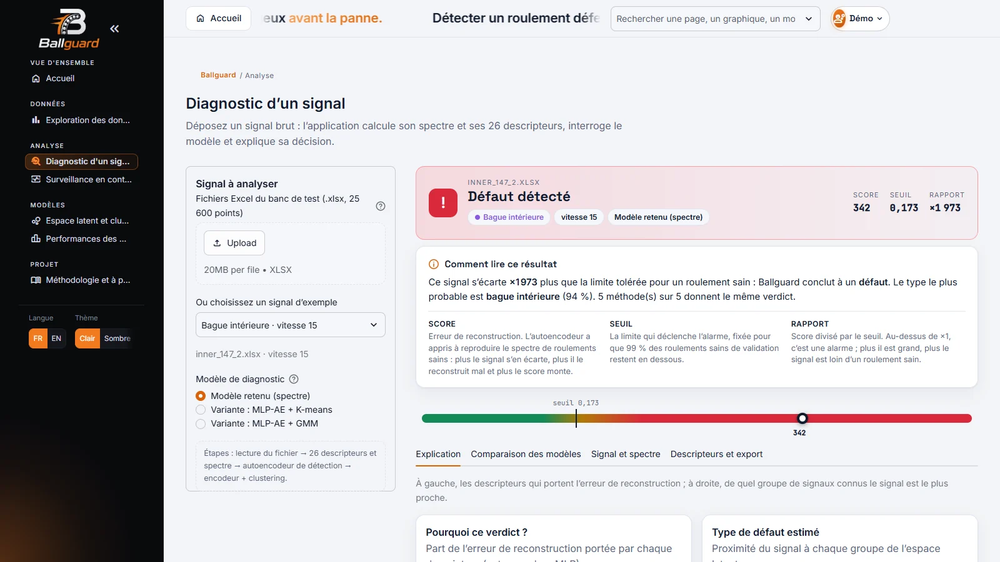
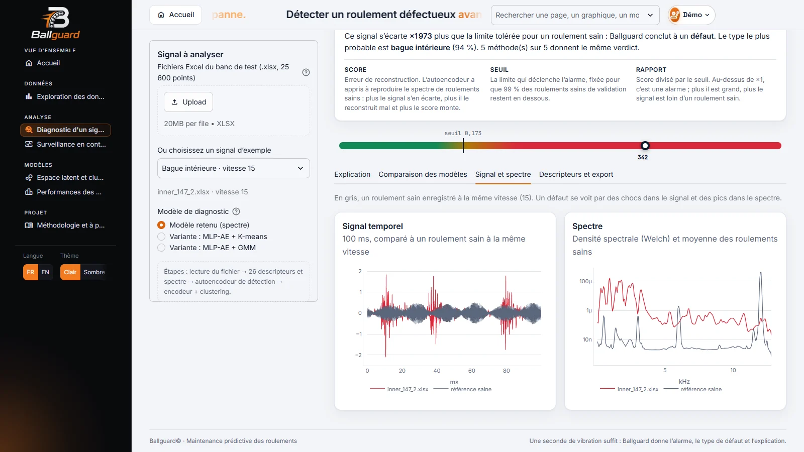
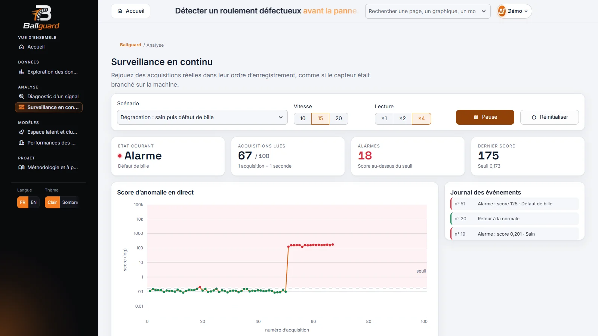
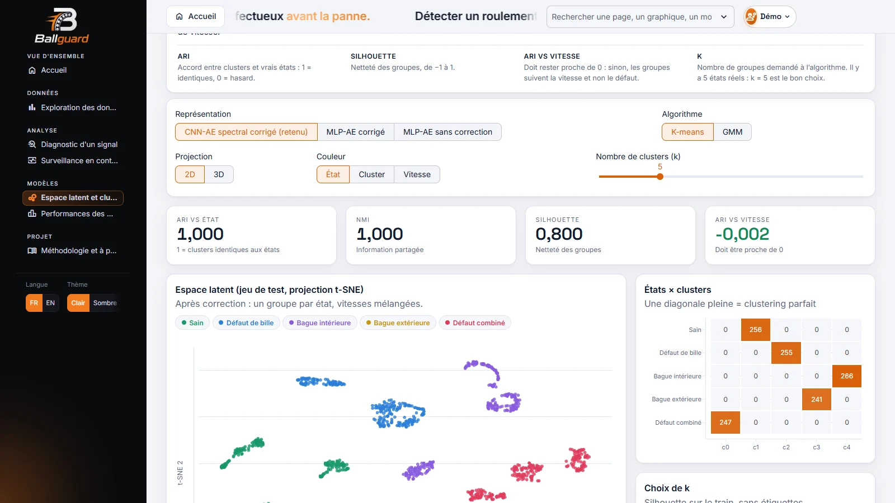
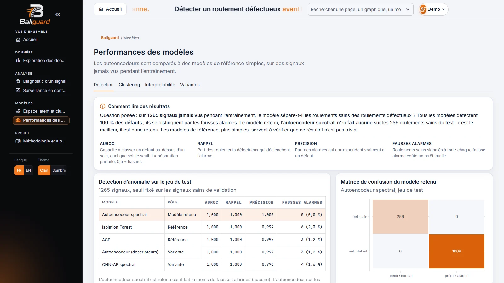
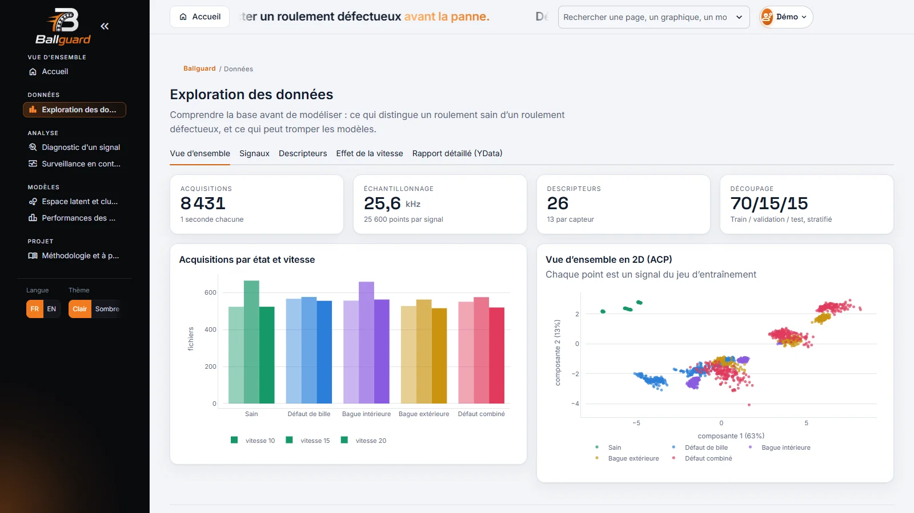
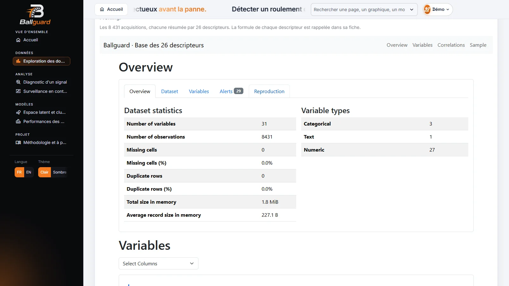
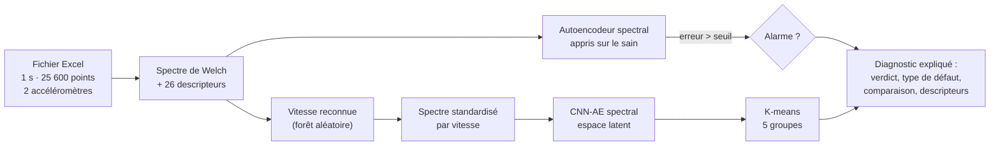

<p align="center">
  
</p>

<h3 align="center">Détecter un roulement défectueux avant la panne</h3>

<p align="center">
  Maintenance prédictive de roulements par <b>autoencodeurs</b> : détection d'anomalie et identification du type de défaut
  à partir d'une seule seconde de vibration.
</p>

<p align="center">
  <a href="https://ballguard.streamlit.app"></a>
  
  
  
  
  
</p>

<p align="center">
  
</p>

Projet ML 3A, sujet 6 : *Autoencodeurs pour le clustering et la détection d'anomalies, appliqués à la maintenance prédictive de roulements.*

## Liens utiles

| | |
|---|---|
| 🚀 **Application en ligne** | [ballguard.streamlit.app](https://ballguard.streamlit.app) |
| 📦 **Dépôt GitHub** | [khalifasimboro/Projet-ML-3A](https://github.com/khalifasimboro/Projet-ML-3A) |
| 📓 **Notebook d'analyse** | [`notebooks/autoencodeurs_roulements_v4.ipynb`](notebooks/autoencodeurs_roulements_v4.ipynb) |
| 🧪 **Étude comparative du groupe** | branche [`feature/gt204-gt205-membre-b`](https://github.com/khalifasimboro/Projet-ML-3A/tree/feature/gt204-gt205-membre-b), résultats dans [`donnees/etude_v6/`](donnees/etude_v6/) |
| 📄 **Rapport (LaTeX)** | [`rapport/`](rapport/) ([compilation Overleaf](rapport/README_Overleaf.md)) |
| 🗓️ **Planning** | [`planning/GANTT.md`](planning/GANTT.md) |

## Sommaire

- [En bref](#en-bref)
- [Résultats](#résultats)
- [Visite de l'application](#visite-de-lapplication)
- [Comment ça marche](#comment-ça-marche)
- [Données](#données)
- [Installation et lancement](#installation-et-lancement)
- [Reproduire les résultats](#reproduire-les-résultats)
- [Déploiement](#déploiement)
- [Structure du dépôt](#structure-du-dépôt)
- [Limites connues](#limites-connues)
- [Équipe](#équipe)

## En bref

À partir d'une seconde de vibration enregistrée sur un banc de test (fichier Excel, 25 600 points), Ballguard :

1. **lit le signal** des deux accéléromètres et **reconnaît la vitesse de rotation** automatiquement ;
2. calcule son **spectre** (méthode de Welch, 0 à 12,8 kHz) et **26 descripteurs** (niveau vibratoire, impulsivité, énergie par bande de fréquence…) ;
3. **détecte une anomalie** : un autoencodeur, entraîné uniquement sur des roulements sains, reconstruit mal un roulement défectueux ;
4. **identifie le type de défaut** (bille, bague intérieure, bague extérieure, défaut combiné) par regroupement dans l'espace latent d'un autoencodeur ;
5. **explique sa décision** : score, seuil, comparaison avec des méthodes de référence, descripteurs en cause.

## Résultats

Tous les chiffres sont mesurés sur le **jeu de test** : 1 265 signaux jamais vus pendant l'entraînement.

### Modèle retenu : le meilleur de chaque étape

| Étape | Modèle retenu | Résultat |
|---|---|---|
| Détection (sain ou défaut) | **Autoencodeur spectral** (512 → 128 → 16 → 128 → 512) | **100 %** des défauts détectés, **0 fausse alarme** sur 256 roulements sains |
| Type de défaut | **CNN-AE spectral + K-means** | **ARI 1,000**, **100 %** d'états corrects, silhouette 0,800 |
| Vitesse de rotation | Forêt aléatoire sur les 26 descripteurs | **100 %** de vitesses reconnues |

### Détection : tous les modèles comparés

| Modèle | Rôle | AUROC | Rappel | Précision | Fausses alarmes |
|---|---|---|---|---|---|
| **Autoencodeur spectral** | **Retenu** | 1,000 | 1,000 | 1,000 | **0** (0,0 %) |
| Isolation Forest | Référence | 1,000 | 1,000 | 0,994 | 6 (2,3 %) |
| ACP (erreur de reconstruction) | Référence | 1,000 | 1,000 | 0,997 | 3 (1,2 %) |
| Autoencodeur (26 descripteurs) | Variante | 1,000 | 1,000 | 0,997 | 3 (1,2 %) |
| CNN-AE spectral | Variante | 1,000 | 1,000 | 0,996 | 4 (1,6 %) |

### Type de défaut : modèles comparés

| Modèle | Rôle | ARI | NMI | Silhouette | États corrects |
|---|---|---|---|---|---|
| **CNN-AE spectral + K-means** | **Retenu** | 1,000 | 1,000 | **0,800** | **100 %** |
| MLP-AE + GMM | Variante | 1,000 | 1,000 | 0,713 | 100 % |
| MLP-AE + K-means | Variante | 0,998 | 0,997 | 0,713 | 99,9 % |

Les deux variantes MLP-AE restent proposées dans l'application : elles travaillent sur les 26 descripteurs et sont donc les seules **explicables descripteur par descripteur**.

> **Remarque de méthode.** Les modèles sont départagés sur leurs scores de test et les écarts entre les meilleurs sont faibles
> (0 contre 3 fausses alarmes, ARI 1,000 contre 0,998). Le seuil de détection, lui, est toujours fixé sur la validation.

## Visite de l'application

L'application compte 7 pages, en **français et en anglais**, avec un **thème clair et un thème sombre**.

### Accueil

Un écran d'ouverture présente le logo, puis demande le nom de l'opérateur (gardé seulement le temps de la session). Le tableau de bord résume les résultats du modèle retenu et le chemin du signal brut au diagnostic.

<p align="center">
  
  
</p>

### Diagnostic d'un signal

On dépose un ou plusieurs fichiers Excel du banc (ou on choisit un signal d'exemple). La vitesse est reconnue automatiquement, et un avertissement apparaît si on en choisit une autre. Le verdict s'accompagne d'une phrase en clair, de la jauge du score, et de quatre onglets : explication, comparaison des modèles, signal et spectre, descripteurs et export.

<p align="center">
  
  
</p>

### Surveillance en continu

Des acquisitions réelles sont rejouées dans leur ordre d'enregistrement, comme si le capteur était branché sur la machine : roulement sain, puis dégradation. Le score, les alarmes et le journal des événements se mettent à jour en direct.

<p align="center">
  
</p>

### Espace latent et Performances

L'espace latent montre comment l'autoencodeur organise les signaux (projection t-SNE, matrice états × groupes, choix du nombre de groupes). La page Performances compare tous les modèles : détection, clustering, interprétabilité et variantes. Chaque page commence par un encadré « Comment lire ces résultats ».

<p align="center">
  
  
</p>

### Exploration des données

Effectifs, signaux, descripteurs (avec leur nom explicite, leur formule et leur signification), effet de la vitesse, et un **rapport YData Profiling** complet sur les signaux bruts et sur la base des 26 descripteurs.

<p align="center">
  
  
</p>

### Thème sombre

<p align="center">
  
</p>

## Comment ça marche



- **Détection.** Les autoencodeurs sont entraînés sur les seuls roulements sains. Le score d'un signal est son erreur de reconstruction. Le seuil est le 99ᵉ percentile des scores des roulements sains de **validation** : au-delà, c'est une alarme.
- **Correction de la vitesse.** La vitesse change fortement les vibrations : sans correction, les groupes se forment par vitesse et non par défaut (ARI ≈ 0,5). On standardise donc séparément chaque vitesse (le spectre pour le modèle retenu ; les descripteurs, après passage de 8 d'entre eux au logarithme, pour les variantes). L'ARI monte alors à 1,000.
- **Type de défaut.** K-means à 5 groupes sur l'espace latent. Les étiquettes servent seulement à nommer les groupes après coup.
- **Explication.** Part de l'erreur portée par chaque descripteur, importance par permutation, comparaison avec Isolation Forest et l'ACP.

Le modèle retenu est désigné à un seul endroit, [`ballguard/config.py`](ballguard/config.py) (`RETENU_DETECTION`, `RETENU_CLUSTERING`). Toutes les pages de l'application s'y réfèrent.

### Les 26 descripteurs

Pour chacun des deux capteurs (vert-bleu `VB` et vert `V`), sur le signal centré *x* :

| Descripteur | Code | Formule |
|---|---|---|
| Niveau vibratoire (RMS) | `rms` | √(moyenne de x²) |
| Impulsivité (kurtosis) | `kurtosis` | E[(x−µ)⁴] / σ⁴ |
| Facteur de crête | `crete` | max\|x\| / RMS |
| Asymétrie (skewness) | `skew` | E[(x−µ)³] / σ³ |
| Amplitude crête-à-crête | `pkpk` | max(x) − min(x) |
| Énergie de 8 bandes de 1,6 kHz (0,05 à 12,8 kHz) | `bande1` … `bande8` | log₁₀ de la somme de la densité spectrale (Welch) sur la bande |

## Données

- **Source** : banc de test de roulements. 5 états mécaniques (sain, défaut de bille, bague intérieure, bague extérieure, défaut combiné), 3 vitesses (10, 15, 20), 2 accéléromètres. Chaque acquisition dure 1 seconde, échantillonnée à 25,6 kHz.
- **Volume** : 8 431 signaux (un fichier illisible écarté sur 8 432).
- **Découpage** : 70 % entraînement (5 902), 15 % validation (1 264), 15 % test (1 265), stratifié par état et vitesse, fixé **avant tout prétraitement**. Les normalisations sont apprises sur l'entraînement, le seuil sur la validation, les scores mesurés sur le test.
- **Dans le dépôt** : la base des descripteurs ([`donnees/descripteurs.csv`](donnees/descripteurs.csv)), les spectres ([`donnees/spectres.npz`](donnees/spectres.npz)) et [15 signaux bruts d'exemple](exemples/) (un par état et par vitesse). Les 4 Go de signaux bruts ne sont pas publiés.

## Installation et lancement

Python **3.11** est requis : les modèles sont enregistrés avec scikit-learn 1.6.1. PyTorch est installé en version CPU (environ 200 Mo).

```bash
git clone https://github.com/khalifasimboro/Projet-ML-3A.git
cd Projet-ML-3A
python -m venv .venv
```

Activer l'environnement : `.venv\Scripts\activate` sous Windows, `source .venv/bin/activate` sous Linux ou macOS. Puis :

```bash
pip install -r requirements.txt
streamlit run app/main.py
```

L'application s'ouvre sur http://localhost:8501. Elle n'a besoin que des fichiers du dépôt.

## Reproduire les résultats

| Commande | Rôle |
|---|---|
| `python scripts/construire_base.py` | Lit les signaux bruts de `data/`, fixe le découpage, calcule descripteurs et spectres (nécessite les 4 Go de données) |
| `python scripts/preparer_exemples.py` | Choisit les 15 signaux d'exemple |
| `python scripts/entrainer.py` | Entraîne tous les modèles et écrit `modeles/` (environ 2 minutes, graine fixée à 42) |
| `python scripts/ajouter_detection_spectre.py` | Ajoute l'autoencodeur spectral retenu à un modèle existant, à l'identique |
| `python scripts/entrainer_vitesse.py` | Entraîne la reconnaissance de la vitesse |
| `python scripts/rapports_profiling.py` | Régénère les rapports YData Profiling (dans un environnement séparé, voir le script) |
| `python scripts/composer_banniere.py image.webp` | Prépare l'illustration de la bannière |

Pour vérifier le backend (18 tests : lecture, descripteurs, diagnostic des 15 exemples, modèle retenu, vitesse) :

```bash
pip install pytest
pytest
```

## Déploiement

L'application est déployée sur **Streamlit Community Cloud** : [ballguard.streamlit.app](https://ballguard.streamlit.app).

| Paramètre | Valeur |
|---|---|
| Dépôt | `khalifasimboro/Projet-ML-3A` |
| Branche | `main` |
| Fichier principal | `app/main.py` |
| Version de Python | 3.11 (paramètres avancés) |

Chaque push sur `main` met l'application en ligne à jour automatiquement, en une à deux minutes.

**Organisation des branches**

| Branche | Rôle |
|---|---|
| `main` | Version de référence, déployée sur [ballguard.streamlit.app](https://ballguard.streamlit.app) |
| `Rydouane` | Développement de l'application ; fusionnée dans `main` une fois les changements vérifiés |
| `feature/gt204-gt205-membre-b` | Étude comparative des autoencodeurs (résultats repris dans `donnees/etude_v6/`) |

Avant chaque fusion dans `main` : lancer `pytest` (18 tests) et vérifier l'application en local avec `streamlit run app/main.py`.

## Structure du dépôt

```
Projet-ML-3A/
├── app/                    Application Streamlit
│   ├── main.py             Point d'entrée : navigation, thème, langue
│   ├── vues/               Les pages (accueil, exploration, diagnostic, surveillance, espace latent, performances, méthodologie)
│   ├── ui/                 Thème, barre du haut, composants, textes FR/EN, chargement des données
│   └── assets/             Logo, illustration, rapports YData Profiling
├── ballguard/              Backend : lecture des signaux, descripteurs, modèles, entraînement, diagnostic, vitesse
├── scripts/                Construction de la base, entraînement, rapports, bannière
├── tests/                  Tests automatiques (pytest)
├── donnees/                Base de descripteurs, spectres, résultats de l'étude comparative
├── modeles/                Modèle entraîné, artefacts affichés, reconnaissance de la vitesse
├── exemples/               15 signaux bruts du banc de test
├── notebooks/              Notebook d'analyse de référence (v4) et version archivée
├── docs/images/            Captures d'écran de ce README
├── rapport/                Rapport LaTeX (compilé par GitHub Actions)
├── planning/               Diagramme de Gantt
├── maquette/               Maquette de navigation
├── bd_v1.pkl               Base de descripteurs au format du notebook
└── modele_final_roulements.joblib   Modèle enregistré par le notebook
```

## Limites connues

- Chaque couple (état, vitesse) est une série d'acquisitions consécutives : le découpage aléatoire place des signaux très proches dans l'entraînement et le test, donc les scores sont **optimistes**. Aucun identifiant de série physique ne permet de faire mieux.
- La vitesse est reconnue automatiquement, mais seulement parmi les trois vitesses du banc (10, 15, 20). Un signal enregistré à une autre vitesse serait rangé à la plus proche.
- Un seul banc de test : la généralisation à d'autres machines n'est pas mesurée.
- Le modèle retenu lit le spectre entier : son erreur ne se décompose pas par descripteur. L'explication par descripteur vient de l'autoencodeur des 26 descripteurs.

## Équipe

KINDO Harouna, HODONOU Firmin, DOMBOUÉ Tidiane, SIMBORO Rydouane.
