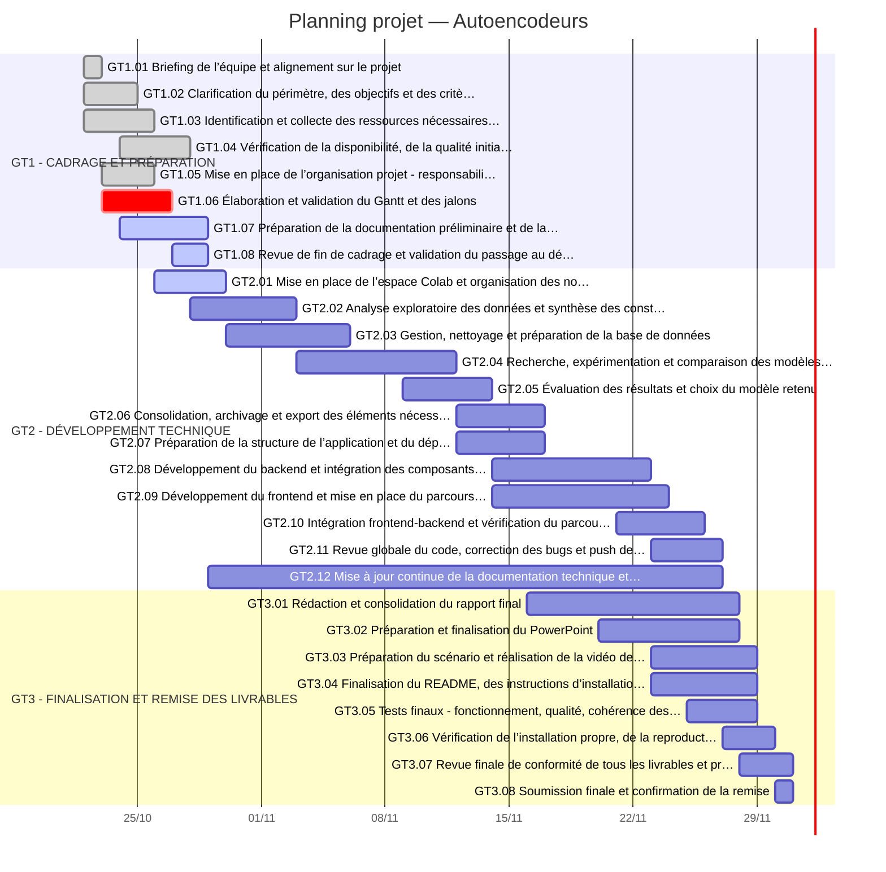

# Planning projet — Autoencodeurs

## Détail des tâches

| ID | Tâche | Responsable | Début | Fin | État |
|---|---|---|---|---|---|
| GT1.01 | Briefing de l’équipe et alignement sur le projet | Membre A | 22/10/2026 | 22/10/2026 | ✅ Terminé |
| GT1.02 | Clarification du périmètre, des objectifs et des critères de réussite | Membre A | 22/10/2026 | 24/10/2026 | ✅ Terminé |
| GT1.03 | Identification et collecte des ressources nécessaires (données, références, outils, accès) | Membre C | 22/10/2026 | 25/10/2026 | ✅ Terminé |
| GT1.04 | Vérification de la disponibilité, de la qualité initiale et des conditions d’utilisation des ressources | Membre C | 24/10/2026 | 27/10/2026 | ✅ Terminé |
| GT1.05 | Mise en place de l’organisation projet : responsabilités, communication et suivi | Membre D | 23/10/2026 | 25/10/2026 | ✅ Terminé |
| GT1.06 | Élaboration et validation du Gantt et des jalons | Membre D | 23/10/2026 | 26/10/2026 | ⏳ À faire |
| GT1.07 | Préparation de la documentation préliminaire et de la structure du rapport | Membre B | 24/10/2026 | 28/10/2026 | ⏳ À faire |
| GT1.08 | Revue de fin de cadrage et validation du passage au développement | Membre B | 27/10/2026 | 28/10/2026 | ⏳ À faire |
| GT2.01 | Mise en place de l’espace Colab et organisation des notebooks | Membre A | 26/10/2026 | 29/10/2026 | ⏳ À faire |
| GT2.02 | Analyse exploratoire des données et synthèse des constats | Membre C | 28/10/2026 | 02/11/2026 | ⏳ À faire |
| GT2.03 | Gestion, nettoyage et préparation de la base de données | Membre A | 30/10/2026 | 05/11/2026 | ⏳ À faire |
| GT2.04 | Recherche, expérimentation et comparaison des modèles potentiels | Membre B | 03/11/2026 | 11/11/2026 | ⏳ À faire |
| GT2.05 | Évaluation des résultats et choix du modèle retenu | Membre B | 09/11/2026 | 13/11/2026 | ⏳ À faire |
| GT2.06 | Consolidation, archivage et export des éléments nécessaires à l’application | Membre C | 12/11/2026 | 16/11/2026 | ⏳ À faire |
| GT2.07 | Préparation de la structure de l’application et du dépôt de développement | Membre D | 12/11/2026 | 16/11/2026 | ⏳ À faire |
| GT2.08 | Développement du backend et intégration des composants de traitement | Membre C | 14/11/2026 | 22/11/2026 | ⏳ À faire |
| GT2.09 | Développement du frontend et mise en place du parcours utilisateur | Membre D | 14/11/2026 | 23/11/2026 | ⏳ À faire |
| GT2.10 | Intégration frontend-backend et vérification du parcours complet | Membre A | 21/11/2026 | 25/11/2026 | ⏳ À faire |
| GT2.11 | Revue globale du code, correction des bugs et push de la version candidate | Membre D | 23/11/2026 | 26/11/2026 | ⏳ À faire |
| GT2.12 | Mise à jour continue de la documentation technique et du suivi des décisions | Membre B | 29/10/2026 | 26/11/2026 | ⏳ À faire |
| GT3.01 | Rédaction et consolidation du rapport final | Membre B | 16/11/2026 | 27/11/2026 | ⏳ À faire |
| GT3.02 | Préparation et finalisation du PowerPoint | Membre A | 20/11/2026 | 27/11/2026 | ⏳ À faire |
| GT3.03 | Préparation du scénario et réalisation de la vidéo de démonstration (15–20 min) | Membre D | 23/11/2026 | 28/11/2026 | ⏳ À faire |
| GT3.04 | Finalisation du README, des instructions d’installation et du guide d’utilisation | Membre C | 23/11/2026 | 28/11/2026 | ⏳ À faire |
| GT3.05 | Tests finaux : fonctionnement, qualité, cohérence des résultats et corrections prioritaires | Membre B | 25/11/2026 | 28/11/2026 | ⏳ À faire |
| GT3.06 | Vérification de l’installation propre, de la reproductibilité et de l’état du dépôt | Membre C | 27/11/2026 | 29/11/2026 | ⏳ À faire |
| GT3.07 | Revue finale de conformité de tous les livrables et préparation du handover | Membre D | 28/11/2026 | 30/11/2026 | ⏳ À faire |
| GT3.08 | Soumission finale et confirmation de la remise | Membre A | 30/11/2026 | 30/11/2026 | ⏳ À faire |
